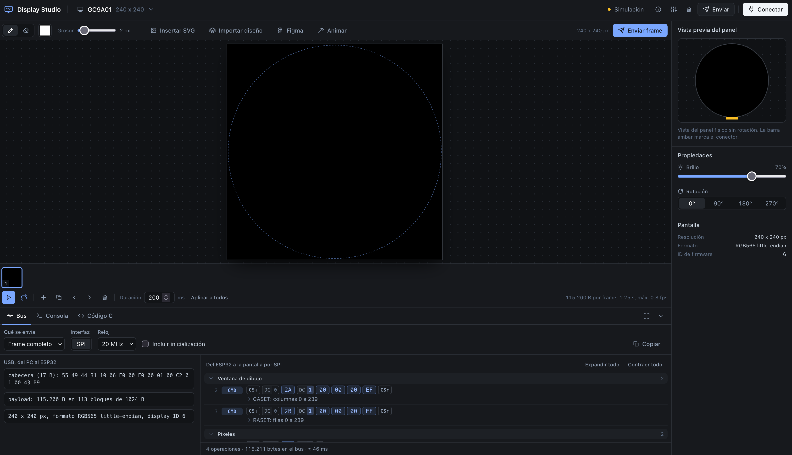

# Display Studio

Diseña interfaces para pantallas de microcontrolador en el navegador y míralas en el panel real al instante.



## Qué es

ESP32 Display Studio es una app web para diseñar lo que muestra una pantalla pequeña: TFT, AMOLED, OLED, e-paper, LCD gráfico o LCD de caracteres, con o sin táctil. Dibujas, importas desde Figma o generas animaciones, y la app:

- **lo envía en tiempo real** a un ESP32 conectado por USB (Web Serial), o
- **lo exporta como código C99** listo para compilar en cualquier microcontrolador.

Mientras diseñas, la vista previa muestra el resultado con el formato real del panel (1 bit con tramado, grises, RGB565...), y el inspector del bus enseña byte a byte lo que viajaría por SPI, I2C o paralelo.

## Funciones

- **Editor de fotogramas**: lápiz, borrador, SVG (biblioteca de iconos o archivo), imágenes y GIF, animaciones generadas (texto, formas, efectos) y reproducción en el panel.
- **Importar diseños**: PNG, JPG, WebP o SVG por archivo, arrastrar o pegar (Cmd+V); y **directamente desde Figma**: cada frame se carga en las pantallas cuyo tamaño coincide (exacto, múltiplo 2x/3x o girado 90°).
- **Cualquier pantalla**: se elige la tecnología y el driver de un catálogo (ST7789, ILI9488, GC9A01, SSD1306, SH1107, SSD1322, SSD1680, UC8179, CO5300, ST7701S, HD44780...) o "Otro". Los parámetros del protocolo se pueden **leer de la hoja de datos en PDF**. Interfaces SPI, QSPI, I2C, paralelo 8080 y RGB, hasta 1024 px por lado.
- **Táctil**: capacitivo o resistivo (FT6x36, GT911, CST816, XPT2046...), exportado con la configuración.
- **LCD de caracteres**: texto, 8 glifos CGRAM y animaciones por filas.
- **Inspector del bus** y estimación de bytes, tiempo y fps por frame.
- **Código C**: bitmaps, configuración y, para pantallas sin soporte integrado, un driver completo generado a partir de su perfil. Descarga suelta o en `.zip`.

## Cómo funciona

```
┌──────────────────────────┐   USB (Web Serial)   ┌──────────────────────┐  SPI / QSPI / I2C /  ┌──────────┐
│ App web (navegador)      │ ───────────────────▶ │ Firmware del micro   │  8080 / RGB          │ Pantalla │
│ editor · Figma · anim.   │  JSON + frames con   │ parser · CRC · driver│ ───────────────────▶ │ + táctil │
│ vista previa · bus · C   │  CRC-16              │ conversión de píxeles│                      │          │
└────────────┬─────────────┘ ◀─────────────────── └──────────────────────┘                      └──────────┘
             │                 READY / OK / ERR
             └─▶ Código C99 exportado: se compila en cualquier microcontrolador, sin USB ni la app
```

1. **En el navegador**, el editor trabaja en RGBA al tamaño lógico del panel (ya rotado). La vista previa reproduce la conversión exacta al formato nativo del chip.
2. **Al enviar**, la app manda primero un comando JSON `config` (pantalla, brillo, rotación) y después cada frame como bloque binario: cabecera de 17 bytes con magic `UID1`, id de pantalla, tamaño, formato y CRC-16/CCITT, seguida del payload en **RGB565** o **mono 1 bpp**. Las pantallas de texto reciben comandos JSON (`lcd`, `glyph`, `glyphAt`, `lcdRaw`).
3. **El firmware** valida la cabecera y el CRC, convierte al formato del controlador (RGB666, grises, páginas de 8 filas, e-paper...) y lo dibuja. Contesta `OK` o `ERR <motivo>`, que la app muestra en su consola.

El protocolo completo está en [src/serial/protocol.js](src/serial/protocol.js) y, con todos los detalles para implementarlo, en los prompts de [prompts/](prompts/).

Sin placa conectada, todo funciona en **modo simulación**: los envíos se registran en la consola con sus tiempos reales.

## Empezar

Requisitos: Node.js 18 o posterior y un navegador con Web Serial (ver más abajo).

```bash
npm install
npm run dev      # http://localhost:5173
npm run build    # versión estática en dist/
```

1. Elige la pantalla en la cabecera, o crea una con **Agregar pantalla**.
2. Dibuja, pulsa **Importar diseño** o **Figma**, o genera una animación con **Animar**.
3. Pulsa **Conectar**, elige el puerto del microcontrolador y luego **Enviar frame**.

### Importar desde Figma

En la app: **Figma** → **Configurar Figma**. Crea un token personal en Figma (Settings → Security → Personal access tokens, con el permiso *File content: Read only*) y pega el enlace del archivo. El modal incluye las instrucciones paso a paso y la tabla de tamaños de frame por pantalla. El token se envía solo a `api.figma.com` y, si lo pides, se guarda únicamente en tu navegador.

## Compatibilidad de navegadores

| Navegador | Soporte |
|---|---|
| Chrome, Edge, Opera de escritorio (89+, Opera 75+) | Completo |
| Firefox, Safari, móviles y tabletas | Diseño, Figma y exportación; la conexión USB se simula |

Web Serial necesita además que la página se sirva desde `https://` o `localhost`. La app lo comprueba al abrirse y lo explica en el aviso **Navegadores compatibles** (botón ⓘ de la cabecera).

## Usarlo con cualquier microcontrolador

Hay dos caminos, según necesites ver los cambios en directo o solo el resultado final.

### 1. Tiempo real por USB: implementa el protocolo

Cualquier micro con un puerto serie por USB puede recibir los diseños. El firmware tiene que:

1. Abrir un puerto serie USB: CDC nativo (baudios irrelevantes) o un puente USB-UART a **921600 8N1**. Ningún log de depuración puede salir por ese puerto.
2. Responder `READY <nombre> <versión>` al conectar.
3. Separar el flujo: líneas que empiezan por `{` son JSON hasta `\n`; bloques que empiezan por `UID1` son frames. Cualquier otro byte se descarta.
4. Validar la cabecera y el CRC-16/CCITT-FALSE (`"123456789"` → `0x29B1`), convertir el payload al formato del panel y dibujarlo.
5. Contestar `OK frame` / `OK config` o `ERR <motivo>`, sin bloquearse nunca: la app no espera confirmación entre bloques ni entre los frames de una animación.
6. Tener una tabla de pantallas cuya **clave** e **id** coincidan con los de la app. Las integradas son `lcd16x2` (1), `lcd20x4` (2), `nokia5110` (3), `ssd1306` (4), `gc9a01` (6) y `st7789` (7). En las creadas en la app, la clave es el nombre en minúsculas con guiones (se ve en la consola al elegirla) y el id el que muestra Propiedades.

Para no escribirlo desde cero, [prompts/](prompts/) tiene prompts completos para pedírselo a un asistente de código:

| Prompt | Plataforma |
|---|---|
| [prompt-firmware-esp32s3.md](prompts/prompt-firmware-esp32s3.md) | ESP32-S3 con ESP-IDF 5 |
| [prompt-firmware-arduino-esp32.md](prompts/prompt-firmware-arduino-esp32.md) | ESP32, S3, C3, C6 y Nano ESP32 con Arduino |
| [prompt-firmware-arduino-placas.md](prompts/prompt-firmware-arduino-placas.md) | RP2040/Pico, Teensy 4, SAMD21/51, Uno R4 y Leonardo con Arduino |

Para otras familias (STM32, nRF52, RA, LPC...) sirve cualquiera de ellos como especificación: el protocolo, la conversión de píxeles y los criterios de aceptación no dependen de la plataforma. La memoria marca el enfoque: si un frame cabe en RAM, se recibe entero y se comprueba el CRC antes de dibujar; si no, se vuelca al panel en streaming. Los micros con un puente USB-UART que no alcanza 921600 baudios con poco error (Uno R3, Nano y Mega a 16 MHz) no sirven para el modo en tiempo real.

### 2. Sin USB: exporta el código C

La pestaña **Código C** genera C99 puro, sin dependencias de microcontrolador, framework ni biblioteca: los bitmaps (RGB565 o 1 bit), `ui_config.h` (resolución, rotación, bus, táctil) y una tabla de objetos o fotogramas. Para integrarlo en tu proyecto:

1. Copia los archivos (o el `.zip`) a tu proyecto.
2. Implementa cuatro funciones con el driver de tu pantalla:

   ```c
   void ui_port_clear(void);                                                       // borra a negro
   void ui_port_blit(int16_t x, int16_t y, const ui_bitmap_t *bm, bool transparent); // dibuja un bitmap
   void ui_port_flush(void);                                                       // vuelca el búfer, si usas uno
   void ui_port_delay_ms(uint32_t ms);                                             // espera
   ```

3. Llama a `ui_screen_draw()` para una pantalla estática o a `ui_animation_run()` para la animación.

En las pantallas con protocolo propio, la app genera además el driver (`drv_<id>.c/.h` y `ui_port.c`) a partir del perfil, y solo hay que implementar el acceso al bus en `drv_port.h`:

```c
void drv_port_write_command(uint8_t cmd);
void drv_port_write_data(const uint8_t *data, size_t len);
void drv_port_delay_ms(uint32_t ms);
void drv_port_reset(void);   // si el panel tiene pin RESET
bool drv_port_busy(void);    // si tiene pin BUSY (e-paper)
```

En los LCD de caracteres se exportan `lcd_ui.c` y `lcd_glyphs.c`, y se implementan `lcd_port_clear`, `lcd_port_set_cursor`, `lcd_port_write` y `lcd_port_create_char`.

### Pantallas que no están en el catálogo

En **Agregar pantalla** elige la tecnología y "Otro / no sé cuál" como driver. Después, en **Hoja de datos**, sube el PDF del controlador: la app busca la resolución, las interfaces, el formato de píxel y la tabla de comandos, y rellena el protocolo. Revisa **Protocolo** y **Secuencias**: la vista previa, el inspector del bus y el driver exportado se generan desde ese perfil.

## Estructura

```
src/
  ui/         interfaz: app, editor, modales (pantallas, Figma, compatibilidad...)
  displays/   catálogo de pantallas, perfiles de protocolo, formatos de píxel,
              inspector del bus, exportación de C, lectura de hojas de datos
  figma/      API de Figma y configuración del token
  serial/     Web Serial, protocolo de frames y CRC-16
prompts/      prompts para generar el firmware (ESP-IDF y Arduino)
docs/         imágenes del README
```

Hecho con JavaScript sin framework, Vite, Tailwind CSS y pdf.js.

## Licencia

[MIT](LICENSE) © 2026 Jesus Velez Soto
